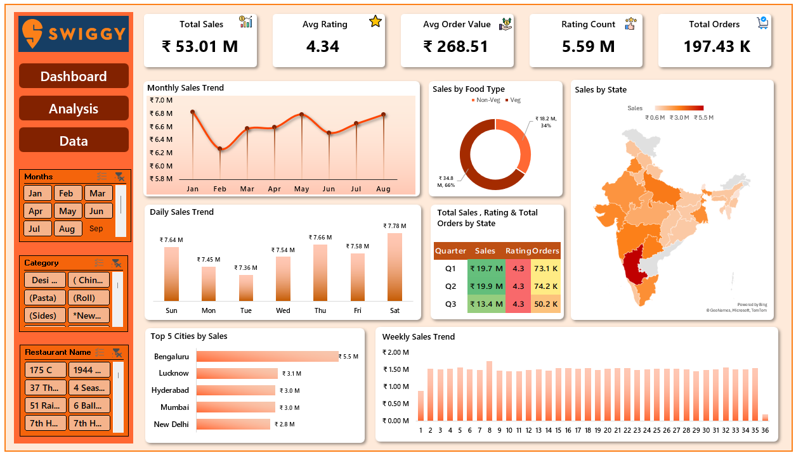

# 🍔 Swiggy Food Delivery Data Analysis | Microsoft Excel

## 📌 Project Overview

This project focuses on analyzing Swiggy food delivery data using Microsoft Excel to understand restaurant performance, food category trends, customer ratings, and pricing patterns.

The dataset contains approximately **197K records** covering food delivery information across different states, cities, restaurants, locations, food categories, and dishes.

The objective is to explore the dataset, summarize key performance indicators, and identify useful business insights through Excel-based data analysis.

## 🎯 Project Objectives

- Analyze overall food ordering activity.
- Understand restaurant and city-wise performance.
- Identify popular food categories and dishes.
- Analyze vegetarian and non-vegetarian food distribution.
- Evaluate restaurant and food ratings.
- Explore monthly pricing trends.
- Compare food prices across different categories and locations.
- Understand customer rating and review patterns.

## 🛠️ Tools & Technologies

- **Microsoft Excel** — Data analysis and reporting
- **Excel Formulas** — KPI calculations and data analysis
- **Pivot Tables** — Aggregation and multidimensional analysis
- **Data Visualization** — Presenting analytical findings

## 📂 Dataset Information

The dataset contains **197,430 records and 14 columns**.

**Data Period:** January 2025 – August 2025

### Important Columns

| Column | Description |
|---|---|
| State | State associated with the restaurant |
| City | Restaurant city |
| Order Date | Order date |
| Days | Day of the week |
| Quauter | Quarter of the year |
| Week Name | Week number |
| Restaurant Name | Restaurant name |
| Location | Restaurant location |
| Category | Food category |
| Dish Name | Name of the food item |
| Food Type | Vegetarian or Non-Vegetarian |
| Price (INR) | Food item price |
| Rating | Restaurant or food rating |
| Rating Count | Number of ratings |

## 📊 Key Performance Indicators (KPIs)

The workbook includes the following summary metrics:

| KPI | Value |
|---|---:|
| Total Price (INR) | ₹53,012,505.77 |
| Average Rating | 4.34 |
| Total Rating Count | 5,591,574 |
| Record Count | 197,430 |
| Average Order Value (AOV) | ₹268.51 |

*These values are based on the existing workbook's Analysis sheet. Record Count is the count of Dish Name records, not a separately verified unique order count.*

## 📈 Analysis Performed

### 1. Overall Performance Analysis

- Total Price analysis.
- Average Rating.
- Total Rating Count.
- Record Count.
- Average Order Value.

### 2. Time-Based Analysis

- Monthly Price analysis.
- Order distribution by day.
- Quarter-wise analysis.
- Week-based analysis.
- Date-based performance exploration.

### 3. Restaurant & Location Analysis

- State-wise analysis.
- City-wise restaurant distribution.
- Restaurant-level performance.
- Location-based food analysis.

### 4. Food Category Analysis

- Category-wise food analysis.
- Dish-level analysis.
- Vegetarian vs Non-Vegetarian distribution.
- Price comparison across food categories.

### 5. Rating Analysis

- Average rating analysis.
- Rating count analysis.
- Restaurant and food rating exploration.

## 📑 Workbook Structure

The Excel workbook contains the following sheets:

| Sheet Name | Purpose |
|---|---|
| Swiggy Data | Main dataset containing food delivery records |
| Analysis | KPI summary and key metrics |
| Sheet3 | Monthly Price summary |
| Dashboard | Dashboard worksheet |

## 💡 Business Questions Explored

1. What is the total price value across the available records?
2. Which cities have the highest restaurant presence?
3. Which restaurants appear most frequently in the dataset?
4. Which food categories are represented most frequently?
5. What is the distribution of Vegetarian and Non-Vegetarian food?
6. How does average rating vary across food items?
7. Which dishes have higher rating counts?
8. How does price performance change month by month?
9. Which locations have a wider variety of food categories?
10. How does food pricing vary across different categories?

## 💼 Business Value

This analysis can help explore:

- Restaurant and location-level food market patterns.
- Food category distribution.
- Pricing patterns across different food items.
- Rating and review activity.
- Monthly changes in recorded food prices.
- Potential opportunities for restaurant and category-level analysis.

These are analytical applications of the dataset; specific business conclusions should be supported by further examination of the results.

## 🧠 Skills Demonstrated

- Microsoft Excel
- Data Analysis
- KPI Development
- Pivot Table Analysis
- Data Aggregation
- Date-Based Analysis
- Restaurant Performance Analysis
- Food Category Analysis
- Rating Analysis
- Business Reporting

## 📷 Project Preview

### Dashboard

## 📁 Project Files

- `Swiggy Raw Data Excel.xlsx` — Excel workbook containing the dataset and analysis.
- `README.md` — Project documentation.
- `screenshots/` — Project preview images.

## 🚀 Project Outcome

This project provided an opportunity to explore a large food delivery dataset and develop practical Excel-based analytical skills.

By analyzing restaurant information, food categories, prices, ratings, and time-based patterns, the project demonstrates how raw data can be organized into meaningful summaries to support business understanding and decision-making.

**Feedback and suggestions are welcome!**
